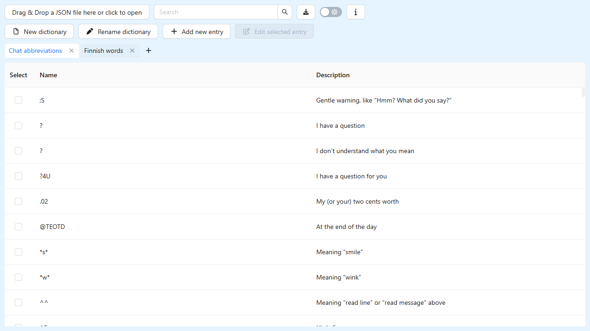
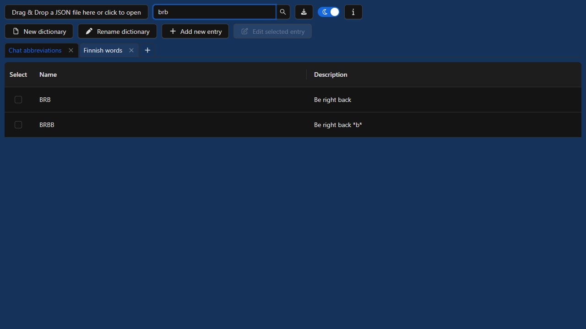
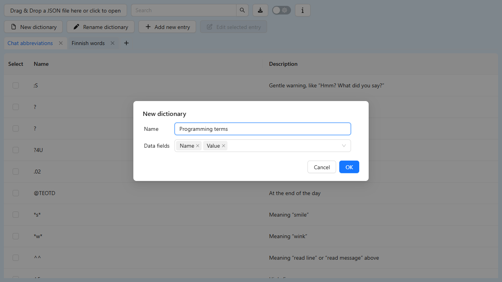

# JSON Dictionary 
A [PWA](https://en.wikipedia.org/wiki/Progressive_web_app) dictionary software using JSON as data format

Keeps dictionaries with user-specified entries for searching, editing and saving. Data can also be exported to or imported from JSON file. The data can be searched with text. The search uses [Fuse.js](https://www.fusejs.io).

## Features
- **Multiple dictionaries in tabs** – each opened JSON file or new dictionary opens in its own tab. Switch between them by clicking a tab, add a new one with the **+** button and close one with the tab's **×** button (closing removes it from the browser storage, so save it first if you want to keep it).
- **Named dictionaries** – give a dictionary a name when creating or importing it (an imported file is named after the file by default). Rename it later with the *Rename dictionary* button or by double-clicking its tab. The dictionary is saved (downloaded) as `<name>.json`.
- **Search** – searches the active dictionary's fields with fuzzy matching and shows the ten best matches.
- **Edit** – add new entries or edit the selected entry.
- **Field selection** – when importing a file, choose which fields are kept and shown.
- **Light and dark theme**.
- **Works offline** – installable as a PWA. All data is stored in the browser's local storage; there is no server.

Dictionaries stored by version 1.0 are opened automatically in a tab named *Dictionary*.

The screenshots of the app using the [sample data](sample_data/chat_abbreviations.json) containing a chat abbreviations dictionary, with a second dictionary open in another tab:



Searching the active dictionary in the dark theme:



Creating a new named dictionary:



## The data format
A JSON data array with unique *id*, and *custom* fields

```json
[
    { "id": 10 , "name": "^5", "description": "High-five" },
    { "id": 11 , "name": "^URS", "description": "Up yours" },
]
```

The *id* values are reassigned when a file is imported.

## Development
Requires [Node.js](https://nodejs.org) 26 or later (CI uses 26.x).

```bash
npm install
npm run dev       # start the Vite development server
npm run build     # type check and build into dist/
npm run lint      # Biome lint and format check
npm test          # run the Jest tests
npm run preview   # serve the production build
```

The tests use [Jest](https://jestjs.io) with [React Testing Library](https://testing-library.com/docs/react-testing-library/intro/) and live in `src/Tests/`.
